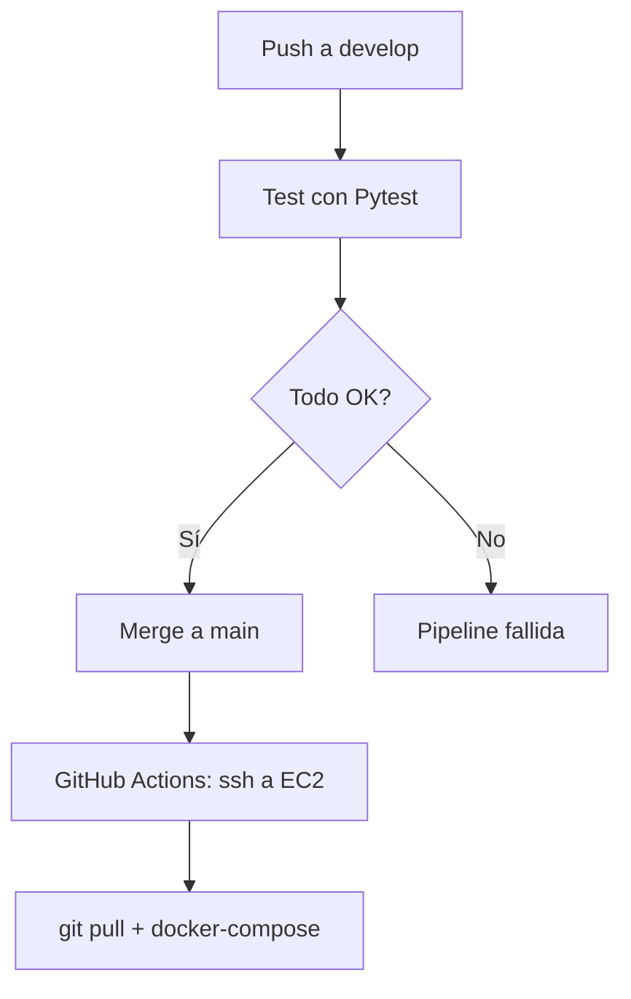

# Proyecto Python DevOps

Ejemplo educativo de un flujo CI/CD de punta a punta: aplicación **Python + Flask** contenerizada con **Docker**, infraestructura gestionada con **Terraform** y despliegue automático a **AWS EC2** mediante **GitHub Actions**.


## Tabla de Contenidos

- [Descripción](#descripción)
- [Características](#características)
- [Requisitos Previos](#requisitos-previos)
- [Instalación](#instalación)
- [Configuración](#configuración)
- [Uso](#uso)
- [Arquitectura](#arquitectura)
- [Stack Tecnológico](#stack-tecnológico)
- [Infraestructura con Terraform](#infraestructura-con-terraform)
- [Despliegue](#despliegue)
- [Testing](#testing)
- [Contribución](#contribución)
- [Documentación](#documentación)
- [Roadmap](#roadmap)
- [Versionado](#versionado)
- [Autores](#autores)
- [Licencia](#licencia)
- [Apóyanos](#apóyanos)

## Descripción

Este proyecto educativo demuestra cómo implementar un flujo de integración y entrega continua (CI/CD) usando GitHub Actions y despliegue automático a una instancia EC2 en AWS. La aplicación está desarrollada en **Python + Flask**, se ejecuta en contenedores Docker, y su infraestructura es gestionada con **Terraform**.

### Flujo CI/CD



## Características

- ✅ API Flask con rutas `/` y `/health`.
- ✅ Tests automatizados con Pytest.
- ✅ Contenerización con Docker y Docker Compose.
- ✅ Infraestructura como código con Terraform (EC2, Security Group, Key Pair).
- ✅ CI/CD con GitHub Actions: tests en cada push/PR y deploy automático a EC2.
- 📋 Linter/formateador y cobertura de tests (ver [roadmap](docs/product/roadmap.md)).

## Requisitos Previos

Antes de comenzar, asegúrate de tener instalado:

- **Python**: v3.14 o superior
- **Docker** y **Docker Compose**
- **Terraform**: v1.x o superior (para la infraestructura)
- **Cuenta de AWS** y un par de claves SSH (para el despliegue)

## Instalación

### 1. Clonar el repositorio

```bash
git clone https://github.com/brayandiazc/proyecto-python-devops.git
cd proyecto-python-devops
```

### 2. Instalar dependencias

```bash
pip install -r requirements.txt
```

### 3. Configurar variables de entorno

```bash
cp .env.example .env
# Edita .env si necesitas cambiar el puerto
```

## Configuración

Las variables se documentan en [`.env.example`](.env.example). La aplicación es
mínima y escucha en el puerto `5000` por defecto. Los secretos de despliegue
(`EC2_HOST`, `EC2_USER`, `EC2_KEY_BASE64`) se configuran como **GitHub Actions
Secrets**, no en local.

> Nunca subas tu archivo `.env` ni claves privadas al repositorio. Ver [SECURITY.md](SECURITY.md) y [`docs/conventions/secrets.md`](docs/conventions/secrets.md).

## Uso

### Desarrollo local

```bash
python app/app.py
# La aplicación quedará disponible en http://localhost:5000
```

### Con Docker

```bash
docker-compose up -d --build
```

### Ejemplos

```bash
curl http://localhost:5000/
curl http://localhost:5000/health
```

Contrato completo de la API en [`docs/architecture/api.md`](docs/architecture/api.md).

## Arquitectura

Resumen de cómo está construido el sistema y del flujo CI/CD en
[`docs/architecture/architecture.md`](docs/architecture/architecture.md).

## Stack Tecnológico

| Capa               | Herramienta                    |
| ------------------ | ------------------------------ |
| Lenguaje principal | Python 3.14                    |
| Framework web      | Flask                          |
| Testing            | Pytest                         |
| Contenedores       | Docker, Docker Compose         |
| CI/CD              | GitHub Actions                 |
| Infraestructura    | Terraform (EC2, SG, Key Pair)  |
| Despliegue         | SSH desde GitHub Actions a EC2 |

Inventario completo en [`docs/architecture/stack.md`](docs/architecture/stack.md).

## Infraestructura con Terraform

### 1. Configura las variables (`terraform/variables.tf`)

```hcl
variable "public_key_path" {
  default = "~/.ssh/id_rsa.pub" # o la que estés usando
}

variable "my_ip" {
  default = "TU.IP.PUBLICA/32" # Ej: "181.55.32.88/32"
}
```

### 2. Inicia y aplica Terraform

```bash
cd terraform
terraform init
terraform apply
terraform output   # obtiene la IP pública de la EC2
```

### 3. Configura la instancia EC2

Conéctate e instala Docker, Docker Compose y Git:

```bash
ssh -i ~/.ssh/id_rsa ubuntu@<IP_PUBLICA>

sudo apt update && sudo apt upgrade -y
sudo apt install -y docker.io docker-compose git
sudo systemctl enable docker && sudo systemctl start docker
sudo usermod -aG docker $USER   # requiere reiniciar sesión
```

## Despliegue

El despliegue es **automático** en cada push a `main` (tras pasar los tests).
Procedimiento detallado, rollback y health checks en
[`docs/conventions/deploy.md`](docs/conventions/deploy.md).

### Secrets de GitHub

En `Settings > Secrets and variables > Actions` agrega:

| Nombre           | Valor                                                                    |
| ---------------- | ------------------------------------------------------------------------ |
| `EC2_HOST`       | IP pública de la instancia EC2 (output de Terraform).                    |
| `EC2_USER`       | Usuario SSH, por ejemplo: `ubuntu`.                                      |
| `EC2_KEY_BASE64` | Clave privada SSH en base64: `base64 -i ~/.ssh/id_rsa` (una sola línea). |

## Testing

```bash
pytest
```

Convenciones de testing en [`docs/conventions/testing.md`](docs/conventions/testing.md).

## Contribución

Lee la [Guía de Contribución](CONTRIBUTING.md) para conocer el flujo de trabajo (Git Flow), los estándares de código, el formato de commits (Conventional Commits) y el proceso de Pull Requests. Respeta también el [Código de Conducta](CODE_OF_CONDUCT.md).

## Documentación

Toda la documentación vive en [`docs/`](docs/README.md):

| Documento                                                                | Responde a                     |
| ------------------------------------------------------------------------ | ------------------------------ |
| [`docs/architecture/architecture.md`](docs/architecture/architecture.md) | ¿Cómo está construido?         |
| [`docs/architecture/stack.md`](docs/architecture/stack.md)               | ¿Con qué tecnologías?          |
| [`docs/architecture/api.md`](docs/architecture/api.md)                   | ¿Qué endpoints expone?         |
| [`docs/conventions/`](docs/conventions/README.md)                        | ¿Cómo trabajamos en este repo? |
| [`docs/decisions/`](docs/decisions/README.md)                            | ¿Por qué cada decisión?        |
| [`docs/product/roadmap.md`](docs/product/roadmap.md)                     | ¿Hacia dónde va?               |
| [`docs/glossary.md`](docs/glossary.md)                                   | ¿Qué significa cada término?   |

## Roadmap

Visión y próximos pasos en [`docs/product/roadmap.md`](docs/product/roadmap.md).

## ¿Qué aprende el estudiante?

- Cómo usar Git, Docker, Terraform, Python y GitHub Actions de forma conjunta.
- Cómo automatizar pruebas y despliegues.
- Cómo montar una arquitectura mínima CI/CD moderna.
- Cómo gestionar claves SSH, variables de entorno y flujos de trabajo seguros.

## Versionado

Usamos [Git](https://git-scm.com) para el control de versiones y seguimos [Semantic Versioning](https://semver.org/). Consulta las [etiquetas](https://github.com/brayandiazc/proyecto-python-devops/tags) para ver las versiones disponibles y el [CHANGELOG](CHANGELOG.md).

## Autores

- **Brayan Diaz C** — [@brayandiazc](https://github.com/brayandiazc)
- **Jplazadelosreyes** — [@Jplazadelosreyes](https://github.com/Jplazadelosreyes)

## Licencia

Este proyecto está bajo la licencia [MIT](LICENSE).

## Apóyanos

Si este proyecto te resulta útil y quieres apoyar su desarrollo:

- [GitHub Sponsors](https://github.com/sponsors/brayandiazc)

---

⌨️ con ❤️ por [@brayandiazc](https://github.com/brayandiazc) y [@Jplazadelosreyes](https://github.com/Jplazadelosreyes)
