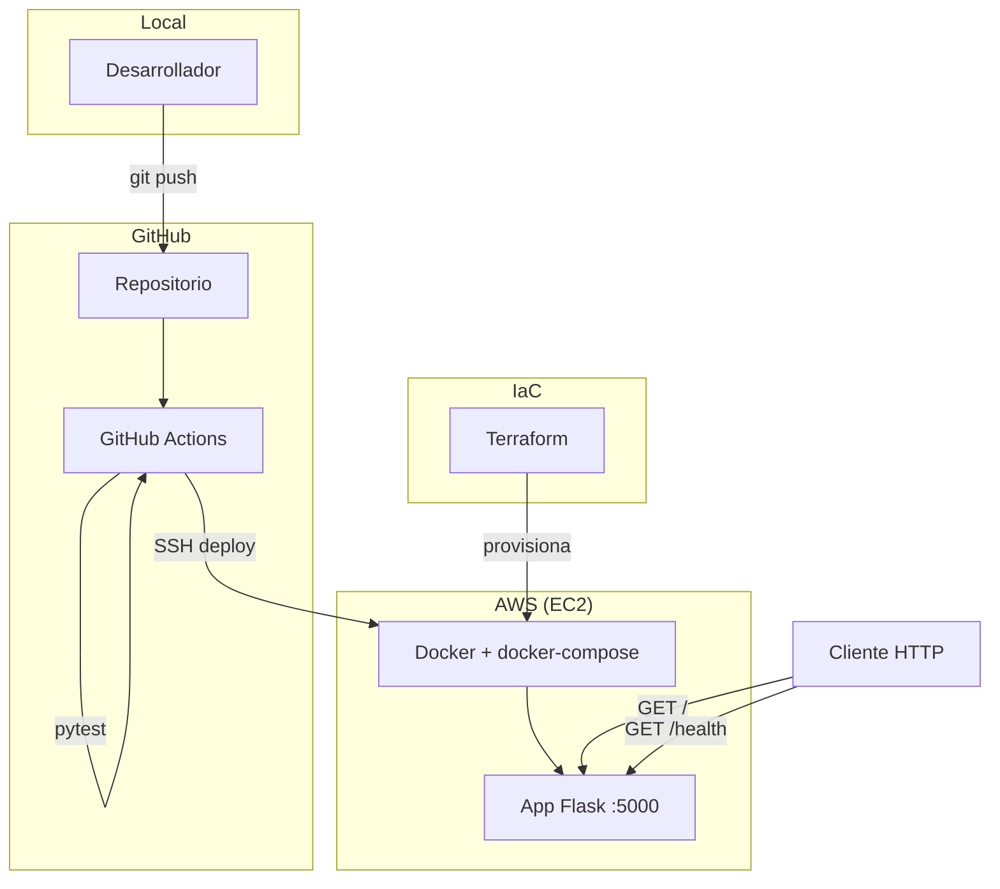
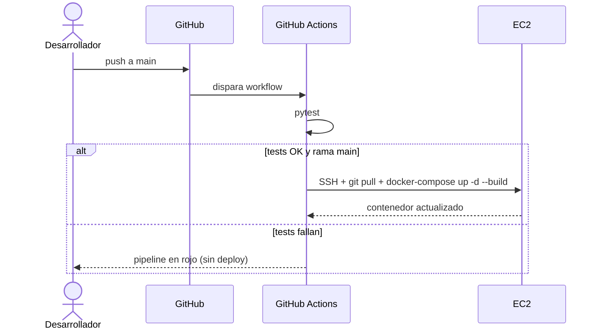

# Proyecto Python DevOps — Arquitectura

> Vista de alto nivel de cómo está construido el sistema y cómo se reparten las
> responsabilidades. Para el stack real (versiones, librerías) ver
> [`stack.md`](stack.md). Para el contrato HTTP ver [`api.md`](api.md).
>
> **Última actualización**: 2026-07-02

## Diagrama

## Componentes

| Componente          | Responsabilidad                                             | Tecnología                |
| ------------------- | ---------------------------------------------------------- | ------------------------- |
| Aplicación web      | Servir las rutas `/` y `/health` sobre HTTP.               | Python 3.11 + Flask       |
| Contenedor          | Empaquetar la app y sus dependencias de forma reproducible. | Docker + Docker Compose   |
| Pipeline CI/CD      | Ejecutar tests y desplegar a EC2 en cada push a `main`.    | GitHub Actions            |
| Infraestructura     | Provisionar la instancia EC2, Security Group y Key Pair.   | Terraform                 |
| Cómputo             | Alojar el contenedor en la nube.                           | AWS EC2 (Ubuntu)          |

## Decisiones clave

| Decisión                               | Razón                                                         |
| -------------------------------------- | ------------------------------------------------------------ |
| Flask como framework web               | Mínimo, ideal para un ejemplo educativo de una API pequeña.  |
| Despliegue por SSH a EC2               | Muestra un flujo CI/CD simple y transparente sin PaaS.       |
| Terraform para la infraestructura      | Infraestructura reproducible y versionada (IaC).             |
| Docker Compose en el servidor          | Un solo comando (`up -d --build`) para levantar/actualizar.  |

> El detalle y las alternativas de cada decisión relevante se registran como
> ADRs en [`../decisions/`](../decisions/README.md).

## Reglas no negociables

- Solo se despliega a producción (EC2) desde la rama `main`, y solo si los tests pasan.
- Las claves y secretos nunca se versionan: viven como GitHub Actions Secrets.
- Cada cambio funcional se acompaña de un test.

## Flujo principal (CI/CD)

## Referencias

- [`stack.md`](stack.md) — stack tecnológico y versiones.
- [`api.md`](api.md) — contrato de API.
- [`../conventions/deploy.md`](../conventions/deploy.md) — cómo se despliega y opera.
- [`../conventions/`](../conventions/README.md) — convenciones de trabajo.
